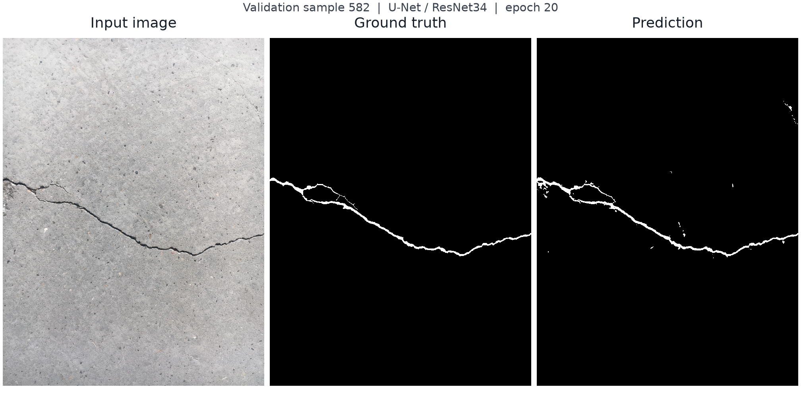

# 混凝土裂缝图像分割

基于 PyTorch 和 segmentation_models_pytorch 的混凝土裂缝二分类语义分割项目，包含成对数据处理、训练验证、检查点恢复、整图滑窗推理和命令行预测。

输入一张 RGB 照片，得到与原图尺寸和位置对齐的裂缝二值 mask，并按预测前景占比判断图片中是否存在裂缝。当前命令行显示原图与预测结果；图片高、宽均须至少512。

## 预测示例



验证集样例582，使用epoch20权重进行整图预测。左至右为原图、真实标注和预测mask，白色表示裂缝。来源：[Özgenel（2019），Concrete Crack Segmentation Dataset v1](https://data.mendeley.com/datasets/jwsn7tfbrp/1)，CC BY 4.0；展示图经方向校正和等比缩放，标注按灰度≥128二值化，预测概率阈值为0.5。

## 结果

模型为 U-Net / ResNet34，训练从 ImageNet 预训练编码器初始化，最终使用epoch20检查点。

| 评价范围 | 全局IoU | Precision | Recall | F1 / Dice |
| --- | ---: | ---: | ---: | ---: |
| 68张验证原图 | 73.79% | 85.57% | 84.27% | 84.92% |
| 68张保留测试原图 | **76.40%** | **87.99%** | **85.29%** | **86.62%** |

指标由整套原图累计像素TP、FP、FN计算。验证集用于选模，测试集在权重与阈值冻结后评价。测试计数为TP=8,848,419、FP=1,207,311、FN=1,525,766。

[验证结果](reports/evaluation/unet_resnet34_validation_metrics.json) · [最终测试报告](reports/evaluation/unet_resnet34_final_test.md) · [评价方法](docs/评价方法.md)

## 使用

环境版本与安装步骤见[环境与复现说明](docs/环境与复现说明.md)。已运行环境为Python3.11.16、PyTorch2.14.1+cu126、torchvision0.29.1+cu126、SMP0.5.0，设备为RTX3060 Laptop 6GiB。完整版本见[依赖锁文件](requirements-lock.txt)，尚未进行全新环境重建验收。

```powershell
git clone https://github.com/taidao1/concrete-crack-segmentation-pytorch.git
cd concrete-crack-segmentation-pytorch
```

准备照片与模型文件后，运行：

```powershell
python -m scripts.predict --image "path/to/photo.jpg" --model "path/to/crack_segmentation_model.pth"
```

`--image`为照片文件，`--model`为模型权重文件。图窗关闭后打印有无裂缝的判断。单图预测支持CUDA，并提供尚未单独验收的CPU回退路径。当前权重仅在本地，公开下载链接尚未提供；权重标识与SHA-256见[评价方法](docs/评价方法.md)。

## 训练与评价

数据集包含458对照片与标注，按原图固定随机划分为322张训练、68张验证、68张测试，seed=1。训练图像与mask同步随机裁剪为512×512；整图推理采用512窗口、末窗贴边及重叠概率平均。数据目录与预处理见[数据说明](docs/数据说明.md)。

在项目根目录运行：

```powershell
python -m scripts.train
python -m scripts.resume
python -m scripts.evaluate --split val
python -m scripts.evaluate --split test
```

上述命令按任务分别使用。`train`从预训练编码器开始训练20轮，Adam学习率1e-4；`resume`默认从epoch17检查点续训5轮，学习率3e-5，固定BN运行统计并继续训练仿射参数。两者以整图验证IoU保存最佳模型。训练、恢复和整图评价入口使用CUDA；路径与参数说明见[代码结构与运行入口](docs/代码结构与运行入口.md)。

## 实验过程

20轮基线最佳验证IoU为62.79%；恢复后降低学习率的五轮分支未提升；固定BN运行统计的三轮续训达到70.64%，随后五轮续训的最佳为73.79%。这些是单种子、不同续训阶段的探索，不能把累计变化全部归因于BN。


[实验条件、失败分支与结论](docs/实验记录.md)

## 适用范围与局限

- 主数据采用随机原图划分，尚未核验场景或建筑来源的独立性。
- 测试图全部有裂缝，68/68检出不能评价无裂缝图片误报率。
- 六张外部弱标签样例仅判对2张，存在纹理误报与细裂纹漏检；这是非随机小样例，不代表总体准确率。标签为推理前暂定的弱标签，未经专家核验，未提供像素级标注。[全部外部案例、结果及许可](reports/evaluation/external_presence_fresh_v1/report.md)
- 当前接口要求图片高、宽至少512，尚未提供通用目录预测或文件导出。

## 目录

```text
crackseg/         数据、模型、训练、指标、推理和检查点模块
scripts/          训练、续训、评价、预测及辅助检查入口
data/             固定划分清单；原始数据放在被Git忽略的raw/目录
docs/             使用说明、数据与评价方法、实验摘要和展示图
reports/          关键实验、最终评价和外部案例的结果证据
```

原始数据和模型检查点不随源码提交。数据集下载、配对规则与布局见[数据说明](docs/数据说明.md)。

## 实现与许可

项目代码实现数据处理、训练验证、检查点管理、整图滑窗和命令行入口；模型架构与预训练编码器复用第三方库。

项目文档与实验记录由AI辅助整理。

项目代码采用[MIT许可证](LICENSE)，版权署名taidao1。数据、外部图片、第三方库和预训练权重分别遵循各自许可。

数据引用：Özgenel, Çağlar Fırat (2019), “Concrete Crack Segmentation Dataset”, Mendeley Data, V1, doi:10.17632/jwsn7tfbrp.1。
