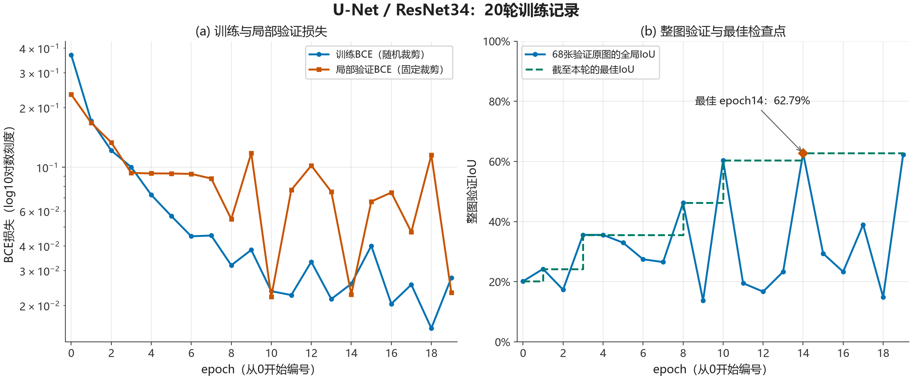

# 实验记录

本项目采用SMP U-Net、ResNet34编码器和ImageNet预训练权重，完成随机裁剪训练、整图滑窗评价及恢复续训。以下记录已完成的实验、负结果和判断依据；评价口径见[评价方法](评价方法.md)。

## 从局部训练到整图评价

早期固定512×512裁剪会反复使用原图的同一区域，无法让训练看到其他位置。训练随后改为配对随机裁剪，验证与推理改为覆盖完整原图的512滑窗。这样既保留细裂缝的原始像素尺度，也控制每步计算规模。

固定局部区域与完整原图不是同一评价范围，两类IoU不直接计算提升幅度。随机裁剪、学习率与BN等探索也有不同训练历史，不视为严格的单因素消融。

## 训练与续训分支

共同设置为BCEWithLogitsLoss、Adam、batch size 2、随机512×512裁剪及322/68/68原图划分。下表成绩均为同68张验证原图的全局像素IoU。

| 实验 | 起点与改动 | 结果与证据 |
| --- | --- | --- |
| 20轮基线 | ImageNet初始化，学习率1e-4，正常更新BN统计 | epoch14最佳 **62.79%**，末轮62.33%；[完整报告](../reports/training/unet_resnet34_bce_random_crop_twenty_epochs.md) |
| 学习率覆盖问题 | 从基线epoch14恢复，先在Adam构造器设3e-5，再加载优化器 | 五轮最佳58.08%，未刷新基线；加载会恢复参数组学习率，且本次缺少运行时生效值打印，因此不能视为有效的低学习率实验；[失败记录](../reports/training/unet_resnet34_resume_lr_override_attempt.md) |
| 有效低学习率续训 | 从同一epoch14另起分支，加载优化器后设置3e-5，并打印确认 | 五轮整图IoU为53.70%、47.71%、44.89%、55.20%、56.42%，**未超过62.79%**；[完整报告](../reports/training/unet_resnet34_resume_lr3e5_five_epochs.md) |
| 固定BN运行统计三轮 | 从epoch14恢复，学习率3e-5，每轮 `model.train()` 后将BN设为eval，仿射参数继续训练 | 62.66% → 65.08% → **70.64%**，最佳epoch17；46层BN运行统计保持不变，仿射参数仍更新；[对照报告](../reports/training/unet_resnet34_bn_stats_fixed_three_epochs.md) |
| 固定BN后再续训五轮 | 从epoch17恢复，学习率3e-5，继续固定BN运行统计 | 64.94%、71.30%、**73.79%**、72.00%、65.05%，最佳epoch20；[完整报告](../reports/training/unet_resnet34_bn_stats_fixed_resume_five_epochs.md) |

两条学习率尝试均从原epoch14另起分支，epoch15–19不能混同为原20轮之后连续追加的训练。优化器状态包含参数组超参数，因此恢复后设置学习率、再打印生效值是这次排错的关键。

固定BN三轮和后续五轮显示了可用的候选策略，但仅有单种子、短续训和不同训练历史。62.79%到73.79%的累计变化不能全部归因于BN，也不足以确诊原波动的唯一原因。低学习率分支无提升同样不能证明模型容量已到上限。最后五轮末轮低于最佳，进一步说明选模应使用固定验证规则，而非默认取最后一轮。

## 冻结版本的最终结果

最终采用epoch20，目录为 `outputs/run_20261024_181934_060182`。

| 范围 | IoU | Precision | Recall | F1 / Dice |
| --- | ---: | ---: | ---: | ---: |
| 68张验证原图 | 73.79% | 85.57% | 84.27% | 84.92% |
| 68张保留测试原图 | **76.40%** | **87.99%** | **85.29%** | **86.62%** |

验证集参与过模型选择；测试结果来自权重与规则冻结后的最终评价。两行属于不同数据，分数差不解释为新的优化收益。测试的累计像素TP=8,848,419、FP=1,207,311、FN=1,525,766，证据见[最终报告](../reports/evaluation/unet_resnet34_final_test.md)、[结构化指标](../reports/evaluation/unet_resnet34_final_test_metrics.json)和[终端输出](../reports/evaluation/logs/unet_resnet34_final_test.txt)。

## 外部照片的失败与适用边界

冻结模型另用于6张外部照片，图片级TP=2、FP=3、FN=1、TN=0，仅判对2张。标签依据发布页信息和图像内容在推理前暂定，未经专家核验，样例也不是随机抽样；没有像素标注，未计算外部IoU。这组结果不能外推总体准确率。

细裂纹漏检，纹理、接缝和边缘出现误报；两张图片级命中的照片也有大面积前景，不能据布尔判断正确认定分割准确。完整失败、图片来源与许可见[六张外部试用报告](../reports/evaluation/external_presence_fresh_v1/report.md)。这些结果表明当前方案仍是学习原型，尚不能据此宣称通用场景或工程应用可靠。

## 实现说明

数据、训练、验证、检查点管理及滑窗推理由项目代码组织；模型架构复用segmentation-models-pytorch，编码器使用ImageNet预训练权重。模块职责见[代码结构与运行入口](代码结构与运行入口.md)。
