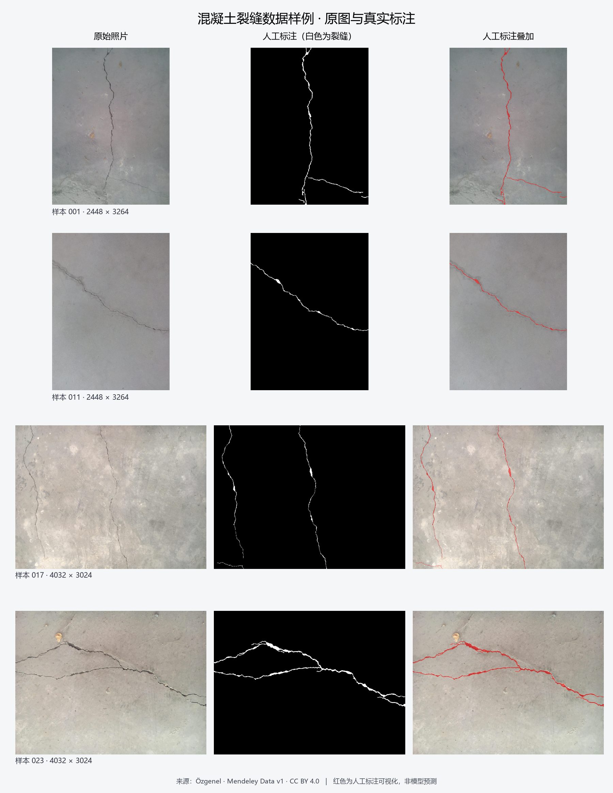

# 数据说明

主数据为Çağlar Fırat Özgenel发布的 [Concrete Crack Segmentation Dataset v1](https://data.mendeley.com/datasets/jwsn7tfbrp/1)（2019，DOI：[10.17632/jwsn7tfbrp.1](https://doi.org/10.17632/jwsn7tfbrp.1)），共458对混凝土照片与裂缝标注，采用 [CC BY 4.0](https://creativecommons.org/licenses/by/4.0/) 许可。原始数据不随源码分发，目录准备见[环境与复现说明](环境与复现说明.md)。

## 样例与处理

图中从左至右为原图、数据集提供的人工标注及红色叠加。展示图经过缩放与标注叠加，标注不是模型预测。该预览使用灰度阈值127作显示处理；训练与评价统一使用灰度值≥128的规则。

读取时分别对原图和标注执行EXIF方向校正，原图转RGB，标注转灰度并按≥128二值化。RGB转float32、除以255，再使用ImageNet mean `[0.485, 0.456, 0.406]` 和std `[0.229, 0.224, 0.225]` 标准化。训练的原图与标注共用随机512×512裁剪坐标；训练过程中另记录固定裁剪的验证损失和IoU，选模与最终报告采用完整原图的滑窗评价。

## 基础审计结果

机器可读结果见 [basic_audit.json](../reports/data/basic_audit.json)，逐对尺寸、方向与统计见 [pairs.csv](../reports/data/pairs.csv)。

| 检查项 | 结果 |
| --- | --- |
| 原始压缩包 | 745,914,150字节 |
| 原图 / 标注 / 配对 | 458 / 458 / 458，无缺配 |
| 严格图像解码 | 916个文件全部成功 |
| 原图、标注各自的文件哈希完全重复 | 均为0组 |
| 原始宽高不一致的配对 | 179对，EXIF规范化后全部458对宽高一致 |
| 原图扩展名 | 257张 `.jpg`、201张 `.JPG`，读取需兼容大小写 |
| 标注编码 | 全部为JPEG；457张RGB、1张L，灰度存在中间值 |

压缩包的本地SHA-256为 `1b8458ab6f84dc5086e9af8579e2cabccd3d209df97b46622096a4c105d5a6b2`，用于文件追溯，未与作者发布哈希比较。

438张原图原始尺寸为4032×3024，其余20张为2448×3264或3264×2448。原图EXIF Orientation分别为1（264张）、6（179张）和3（15张），标注均为1。Orientation 3旋转不会交换宽高，因此不能只靠尺寸检查判断方向是否正确。三个抽样叠加的标注与裂缝总体对齐，尚未对458对全部进行人工空间对齐和标注质量检查。

早期审计按临时阈值127统计，未发现空标注，全局前景占比约1.3641%；这一数字属于该次审计口径，不能替代正式≥128规则的统计。JPEG标注中存在灰度中间值及通道差异，不能将原文件直接当作严格0/255的单通道mask。

## 固定划分与边界

按原图编号随机划分，seed=1：

| 划分 | 数量 | 清单 |
| --- | ---: | --- |
| 训练 | 322 | [train_ids.txt](../data/train_ids.txt) |
| 验证 | 68 | [val_ids.txt](../data/val_ids.txt) |
| 测试 | 68 | [test_ids.txt](../data/test_ids.txt) |

三份清单合计458个唯一编号，编号之间无交集；同一原图的裁剪块属于该原图所在集合。验证集用于选模，测试集在权重和推理规则冻结后评价，详见[评价方法](评价方法.md)。

本划分是原图随机划分。近重复、建筑或拍摄场景关联尚未核验，不能据编号无交集宣称场景独立。文件哈希无完全重复也不能排除重编码图片、近重复或共同场景。压缩包没有官方划分和场景元数据。

外部照片单独存放，不混入三份清单。[六张外部照片试用](../reports/evaluation/external_presence_fresh_v1/report.md)使用推理前目视暂定的图片级弱标签，没有像素真值；其结果与主数据集分割指标分别报告。图片作者、许可和加工方式见该报告及其来源清单。

数据引用：Özgenel, Çağlar Fırat (2019), “Concrete Crack Segmentation Dataset”, Mendeley Data, V1, doi: 10.17632/jwsn7tfbrp.1。
