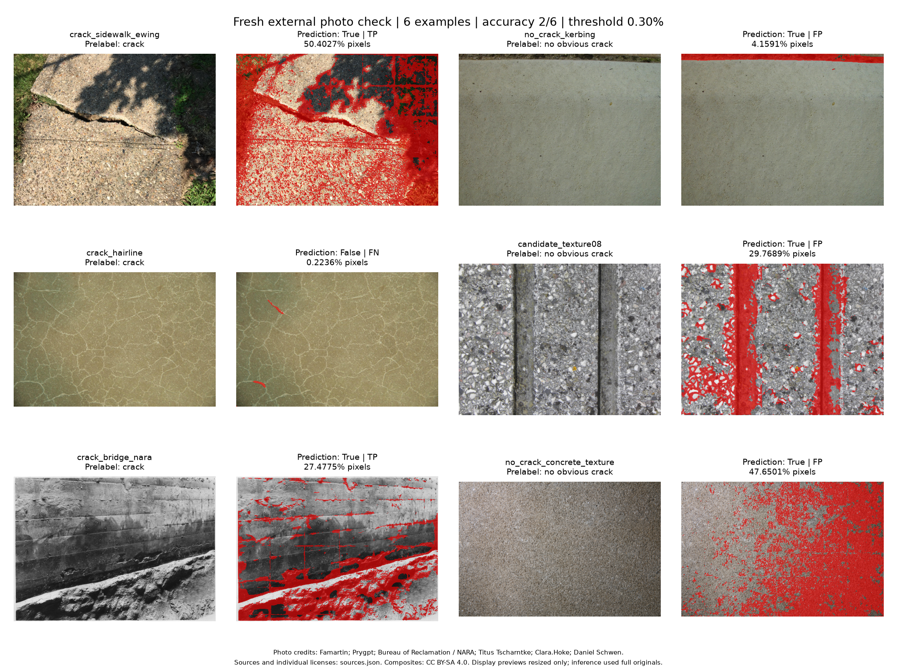

# 新收集外部照片：裂缝存在性小规模验证

日期：2026-10-24。使用冻结的epoch20模型与既定阈值，对六张外部照片进行图片级裂缝存在性评价。

**这批6张照片中，判对2张，图片级准确率为33.33%。细裂缝漏检1张，暂定无裂缝的3张均误报。** 以下展示全部样例和推理前确定的弱标签。

## 数据与执行范围

- 6 张新收集的 Wikimedia Commons 原尺寸照片，单独放在 `data/raw/external_presence_fresh_v1/images/`，未加入原训练、验证或独立测试清单。
- 推理前依据发布页说明和原图内容，冻结暂定标签：3 张有裂缝、3 张无明显裂缝。它们不是专家真值；`Texture 08` 的两条直线暗槽暂按加工槽/接缝处理，阴性标签把握为中等。
- 样例包含人行道、细裂纹地面、黑白桥墩和不同混凝土纹理，未随机抽样。本次是外部试用，不能用 33.33% 推断总体准确率，也不能宣称专业工程性能。
- 权重：`outputs/run_20261024_181934_060182`，epoch 20。CUDA，原尺寸推理，不缩放；原滑窗及概率阈值 **0.5** 保持不变。
- 图片存在性规则：调用原 `if_exist(mask, threshold_rate=0.003)`，即预测裂缝像素占比达到 **0.3%** 时返回 `True`。
- 模型与预处理使用项目现有推理函数。图像处理阶段墙钟 **14.78秒**，不含导入、下载与绘图。

来源、作者、许可、尺寸、SHA256 和推理前标签依据见 [sources.json](sources.json)；完整数值及每张 mask 路径见 [results.json](results.json)。这些图片未用于本项目此前训练或阈值选择，但没有证明它们绝不与编码器预训练来源重合。

## 完整结果

尺寸按宽 × 高；“有/无”均指本次推理前的暂定图片标签。

| 照片 | 原尺寸 | 暂定标签 | 预测裂缝像素占比 | 预测 | 结果 |
| --- | ---: | --- | ---: | --- | --- |
| 老旧人行道裂缝 `crack_sidewalk_ewing` | 3264 × 2448 | 有 | 50.4027% | `True` | TP |
| 细裂纹 `crack_hairline` | 2000 × 1328 | 有 | 0.2236% | `False` | FN，漏检 |
| 黑白桥墩裂缝 `crack_bridge_nara` | 3000 × 2145 | 有 | 27.4775% | `True` | TP |
| 路缘混凝土纹理 `no_crack_kerbing` | 2560 × 1920 | 无 | 4.1591% | `True` | FP，误报 |
| 直槽纹理 `candidate_texture08` | 1280 × 960 | 无，中等把握 | 29.7689% | `True` | FP，误报 |
| 粗糙混凝土纹理 `no_crack_concrete_texture` | 4368 × 2912 | 无 | 47.6501% | `True` | FP，误报 |

| 图片级指标 | 结果 | 本次计算含义 |
| --- | ---: | --- |
| TP / FP / FN / TN | 2 / 3 / 1 / 0 | 按上述冻结标签统计 |
| Accuracy | 33.33% | 6 张中判对 2 张 |
| Precision | 40.00% | 5 张预测阳性中，2 张暂定为真阳性 |
| Recall | 66.67% | 3 张暂定阳性中，检出 2 张 |
| 阴性误报率 | 100.00% | 3 张暂定阴性全部误报 |

以上均为**图片级**指标，与验证集像素级 IoU 73.79%、Precision 85.57%、Recall 84.27% 不是同一评价。外部照片没有像素标注，未计算外部 IoU。

如果排除标签把握较低的 `Texture 08`，其余5张仍只判对2张（40%）；因此外部样例暴露的问题不完全取决于这张中等把握的阴性标签。

## 可视化与结论

放大查看：[有裂缝样例对照](positive_comparison.png) · [暂定无裂缝样例对照](negative_comparison.png)。每张完整预测 mask 已单独保存，路径见 `results.json`。

**这批样例的矛盾不能只靠全图占比阈值解决。** 细裂纹图的预测占比只有 0.2236%，低于 0.3% 而被漏掉；三张暂定阴性却分别达到 4.1591%、29.7689%、47.6501%。在这些 mask 不变的条件下，把阈值降低到能检出细裂纹，仍会把三张阴性判为有裂缝；提高阈值也无法挽回细裂纹的漏检。

图片级 TP 只表示“有裂缝”这一布尔判断命中，**不代表预测的裂缝区域正确**。两张命中的阳性图分别有约 50% 和 27% 的像素被判为裂缝，需要结合叠加图审视大面积前景，不能当作精确分割成功案例。

不同材料纹理、拍摄条件与黑白照片等差异可能影响模型表现，本次没有对各因素做因果诊断。以上结果属于固定模型与规则下的外部试用。

## 图片来源与许可

| 图片 | 作者 / 来源机构 | 原页许可 |
| --- | --- | --- |
| [老旧人行道裂缝](https://commons.wikimedia.org/wiki/File:2017-09-05_10_53_35_Large_crack_in_very_old_concrete_sidewalk_along_Theresa_Street_in_Ewing_Township,_Mercer_County,_New_Jersey.jpg) | Famartin | CC BY-SA 4.0 |
| [Hairline cracks](https://commons.wikimedia.org/wiki/File:Hairline_cracks.jpg) | Prygpt | CC BY-SA 4.0 |
| [桥墩裂缝，NARA 294290](https://commons.wikimedia.org/wiki/File:Close_view_of_crack_in_concrete_on_east_side_of_highway_bridge_pier_no._2_-_NARA_-_294290.jpg) | Bureau of Reclamation / NARA，摄影者未记载 | 公有领域，PD-USGov |
| [Concrete kerbing texture](https://commons.wikimedia.org/wiki/File:Concrete_kerbing_texture.jpg) | Titus Tscharntke | 公有领域，PD-author |
| [Texture 08](https://commons.wikimedia.org/wiki/File:Texture_08.JPG) | Clara.Hoke | CC0 1.0 |
| [Concrete texture](https://commons.wikimedia.org/wiki/File:Concrete_texture.jpg) | Daniel Schwen | CC BY-SA 4.0 |

原图遵循各自许可。总览与对照图对原图做了排版、显示缩放、预测 mask 及叠加处理；这些组合展示图以 [CC BY-SA 4.0](https://creativecommons.org/licenses/by-sa/4.0/) 提供，原作者归属见上表与 `sources.json`。此说明只适用于相应图像材料，不改变整个项目代码的许可。
