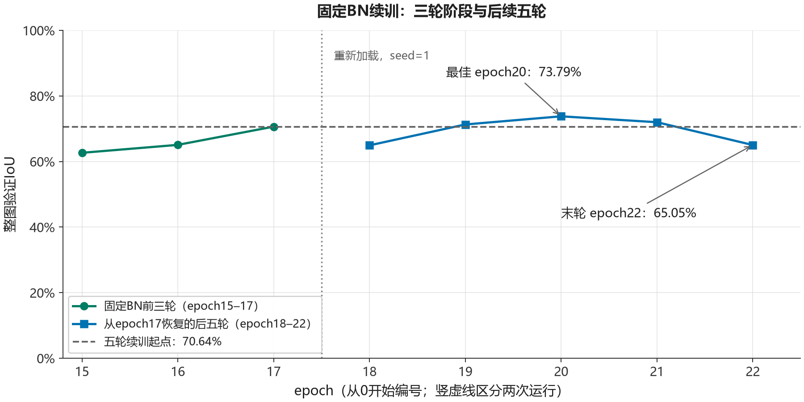

# 固定BN运行统计：从epoch17继续五轮

日期：2026-10-24。从固定BN三轮实验的epoch17检查点继续训练五轮。

## 实验条件

从[固定BN三轮对照](unet_resnet34_bn_stats_fixed_three_epochs.md)的最佳检查点outputs/run_20261024_174146_218961恢复，起点epoch17的整图验证IoU为70.64%。加载后打印的实际学习率为[3e-05]。

模型、损失和更新沿用SMP U-Net / ResNet34、BCEWithLogitsLoss、Adam、batch size 2及配对随机512×512裁剪。原图划分为322训练/68验证/68测试，本次未使用测试集；每轮做固定局部验证与全部68张原图整图验证，像素阈值0.5。每轮model.train()之后固定BN运行统计，仿射参数继续训练；本次没有逐层缓冲区检查，不能将此前三轮的检查记录扩展为本次实测结论。

本次在新进程中恢复并重新seed=1，未恢复全部随机状态，编号epoch18–22不代表同一进程中的无中断轨迹。

## 结果

| epoch | 训练BCE | 在线训练IoU | 局部验证BCE | 局部验证IoU | 整图验证IoU | 新最佳保存 |
| ---: | ---: | ---: | ---: | ---: | ---: | :---: |
| 18 | 0.019018 | 69.38% | 0.009030 | 54.02% | 64.94% | |
| 19 | 0.017785 | 71.83% | 0.009133 | 66.43% | 71.30% | 是 |
| 20 | 0.023321 | 69.36% | 0.006925 | 71.26% | 73.79% | 是 |
| 21 | 0.049278 | 56.30% | 0.011715 | 64.40% | 72.00% | |
| 22 | 0.019373 | 68.83% | 0.009115 | 52.16% | 65.05% | |

精确数值和阶段耗时见[逐轮JSON](unet_resnet34_bn_stats_fixed_resume_five_epochs_metrics.json)，来源为项目作者的运行输出。

最佳epoch20的IoU为0.7378894749145102（73.79%），比起点增加3.1488个百分点。最佳目录为outputs/run_20261024_181934_060182；epoch19也保存了检查点outputs/run_20261024_181547_042273。末轮epoch22为65.05%，比最佳低8.7435个百分点；本分支范围为64.94%–73.79%，仍存在回落。最佳检查点附带历史止于epoch20，逐轮JSON另外保留了epoch21–22。

图中前三点对应固定BN的三轮续训，后五点对应从epoch17重新加载后的五轮续训；分段标出重新加载，纵轴为0–100%，未平滑或删除回落轮次。训练、局部验证和整图验证的阶段累计分别为620、120、376秒，合计1116秒（18分36秒），不含启动、加载与保存，不是纯模型吞吐。

## 评价与限制

本次增加轮数后最佳验证IoU继续提高，但单种子、不同恢复阶段的累计收益不能全部归因于BN。末轮回落也不足以确认过拟合或架构能力上限；在线训练、固定局部验证与整图验证覆盖不同范围，不能直接相减解释模块贡献。原图随机划分尚未核验跨场景独立性。

epoch20随后在同一验证集测得P85.57%、R84.27%，由P/R派生F1为84.92%，来源为[验证指标JSON](../evaluation/unet_resnet34_validation_metrics.json)与[原始输出](../evaluation/logs/unet_resnet34_validation.txt)；这些验证结果参与选模，不能作为独立测试。冻结版本的评价另见[最终测试报告](../evaluation/unet_resnet34_final_test.md)。
