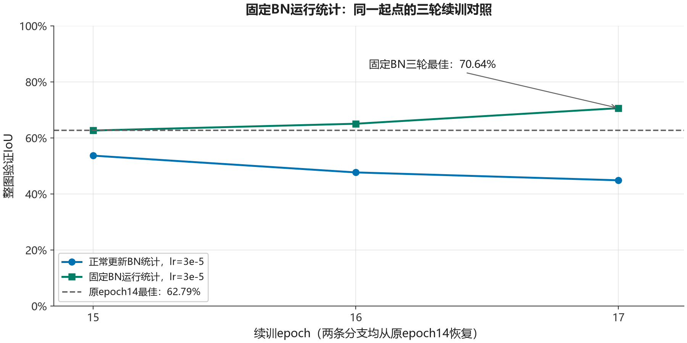

# 固定BatchNorm运行统计：三轮续训对照

日期：2026-10-24。从同一epoch14检查点恢复，以固定BN运行统计与正常更新BN的分支进行三轮对比。

## 实验条件

从[20轮基线](unet_resnet34_bce_random_crop_twenty_epochs.md)的epoch14检查点outputs/run_20261024_161026_887520恢复模型、Adam状态及历史，起始整图验证IoU为0.6279036106314678（62.79%）。加载优化器后将实际学习率设为3e-5并打印确认，训练epoch15–17。

模型为SMP U-Net / ResNet34，损失为BCEWithLogitsLoss，batch size 2，workers=0，CUDA / RTX3060 Laptop 6 GiB。沿用322训练/68验证/68测试的原图随机划分，本次不使用测试集；Python与Torch重新seed=1，未恢复完整旧随机状态。训练每张原图每轮随机同步裁剪512×512，局部验证及68张整图验证的调用顺序与[有效小学习率分支](unet_resnet34_resume_lr3e5_five_epochs.md)保持一致。整图以512窗口覆盖、重叠平均sigmoid概率、0.5阈值及全局像素计数计算IoU。

训练策略的变化是：每轮model.train()后，将全部46层BatchNorm2d设为eval()以固定运行统计，BN的weight和bias仍保留梯度与更新。实验记录逐轮检查running_mean、running_var和num_batches_tracked，以及仿射参数是否更新；配置见[配置JSON](unet_resnet34_bn_stats_fixed_three_epochs_config.json)。该配置记录的是当次实验版本。

## 结果与对照

| epoch | 训练BCE | 在线训练IoU | 局部验证BCE | 局部验证IoU | 整图验证IoU | BN统计不变 / 仿射更新 |
| ---: | ---: | ---: | ---: | ---: | ---: | :---: |
| 15 | 0.030158 | 58.91% | 0.013984 | 44.46% | 62.66% | 是 / 是 |
| 16 | 0.021984 | 66.70% | 0.018748 | 36.90% | 65.08% | 是 / 是 |
| 17 | 0.026525 | 67.36% | 0.009651 | 61.90% | 70.64% | 是 / 是 |

三轮中全部46层BN的运行均值、方差及批次计数均保持不变，每轮均有BN仿射参数实际更新。精确指标与检查结果见[逐轮JSON](unet_resnet34_bn_stats_fixed_three_epochs_metrics.json)。epoch16保存IoU65.08%的检查点，epoch17保存本分支最佳outputs/run_20261024_174146_218961，IoU=0.7064012611700268（70.64%），比起点增加约7.85个百分点。

与普通BN、同为3e-5且从同一epoch14检查点出发的分支，按相同前三轮比较：

| epoch | 普通BN | 固定BN运行统计 | 差值（百分点） |
| ---: | ---: | ---: | ---: |
| 15 | 53.70% | 62.66% | +8.96 |
| 16 | 47.71% | 65.08% | +17.37 |
| 17 | 44.89% | 70.64% | +25.75 |

三轮记录耗时分别约232.50、232.14、233.44秒，合计698.08秒；启动至训练结束的墙钟时间为705.420039秒，包含初始化、恢复和输出，不含后续重载复核。

## 保存后重载复核

训练结束后重新创建同结构模型、加载epoch17权重，对相同68张验证图复核。IoU与训练阶段精确一致；这是同一验证集上的保存/加载一致性检查。

| 全局像素指标 | 数值 |
| --- | ---: |
| TP / FP / FN | 8,957,820 / 1,095,295 / 2,627,808 |
| IoU | 0.7064012611700268（70.64%） |
| Precision | 0.8910491922155471（89.10%） |
| Recall | 0.7731838101482285（77.32%） |
| F1 | 0.8279427321633239（82.79%） |

复核墙钟时间为80.44569980000233秒，包含模型创建与加载。来源见[重载复核JSON](../evaluation/unet_resnet34_bn_stats_fixed_reload_validation.json)。

## 解释限制

两条分支均从相同epoch14恢复、重新seed=1，其他采样、学习率和评价调用顺序保持；它们是不同进程的单种子短期对照，不是原20轮后的连续第21–23轮。固定BN统计也改变训练前向的归一化方式，不能把影响进一步归结为某一个缓冲区。

本次结果支持固定BN统计作为候选改进，不能证明它是所有波动的唯一根因或保证长期稳定。原epoch14模型缺少本次同口径P/R测量，不能将P/R变化全部归因于BN。原图随机划分尚未核验场景独立性；参与选模的验证成绩不能替代最终测试或外部泛化。后续使用该检查点的结果见[五轮续训记录](unet_resnet34_bn_stats_fixed_resume_five_epochs.md)。
